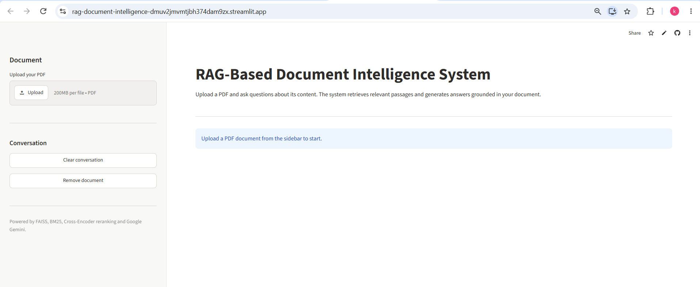
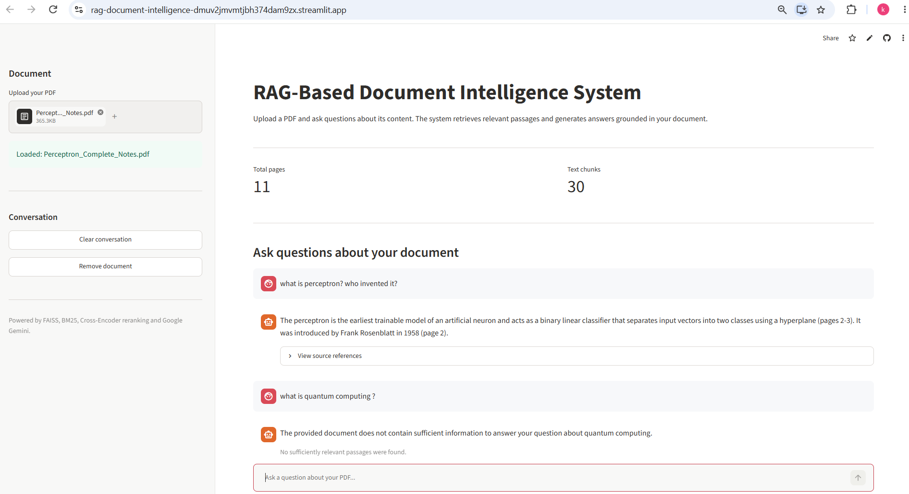

# RAG-Based Document Intelligence System

An end-to-end Retrieval-Augmented Generation (RAG) system that enables users to interact with PDF documents through natural-language questions. The system combines semantic search, keyword-based retrieval, Reciprocal Rank Fusion (RRF), and CrossEncoder reranking to retrieve relevant information before generating grounded answers using Google Gemini.

## Key Features

- **PDF Processing:** Extracts text from PDF documents while preserving page-level metadata.
- **Document Chunking:** Splits extracted text into overlapping chunks for effective retrieval.
- **Semantic Search:** Uses Sentence Transformers embeddings and FAISS vector search.
- **Hybrid Retrieval:** Combines dense retrieval with BM25 keyword search.
- **Reciprocal Rank Fusion:** Merges results from multiple retrieval methods.
- **CrossEncoder Reranking:** Reorders retrieved passages based on query-document relevance.
- **Grounded Answer Generation:** Uses Google Gemini to generate responses based on retrieved document context.
- **Source Attribution:** Includes page references to help users verify generated answers.
- **Conversation Support:** Maintains conversation history and handles follow-up questions through query reformulation.
- **Query Preprocessing:** Applies document-aware spelling correction.
- **Out-of-Context Handling:** Abstains when the retrieved document context does not support an answer.
- **Interactive Interface:** Provides a Streamlit application for uploading PDFs and asking questions.

## System Architecture

```text
                 PDF Document
                      |
                      v
                  PDF Loader
                      |
                      v
                Text Extraction
                      |
                      v
                 Text Chunking
                      |
                      v
                Embedding Model
                      |
                      v
                  FAISS Index
                      |
           +----------+----------+
           |                     |
           v                     v
      FAISS Search           BM25 Search
           |                     |
           +----------+----------+
                      |
                      v
           Reciprocal Rank Fusion
                      |
                      v
             Candidate Retrieval
                      |
                      v
             CrossEncoder Reranking
                      |
                      v
              Relevant Context
                      |
                      v
                Gemini LLM
                      |
                      v
           Grounded Answer + Sources
```

## Technology Stack

| Component | Technology |
|---|---|
| Programming Language | Python |
| PDF Extraction | PyPDF |
| Text Chunking | LangChain Text Splitters |
| Embeddings | Sentence Transformers |
| Embedding Model | all-MiniLM-L6-v2 |
| Vector Database | FAISS |
| Keyword Retrieval | BM25 |
| Ranking Fusion | Reciprocal Rank Fusion |
| Reranking | CrossEncoder |
| Reranking Model | ms-marco-MiniLM-L-6-v2 |
| Language Model | Google Gemini |
| User Interface | Streamlit |
| Evaluation | Precision@K, Recall@K, MRR, Hit Rate, Answer Quality Metrics |

## Project Structure

```text
rag-document-intelligence/
|
├── data/
│   └── sample_documents/
│       └── sample.pdf
|
├── screenshots/
│   ├── app-interface.png
│   └── answer-with-sources.png
|
├── src/
│   ├── pdf_loader.py
│   ├── text_splitter.py
│   ├── embeddings.py
│   ├── vector_store.py
│   ├── retriever.py
│   ├── query_preprocessor.py
│   └── rag_pipeline.py
|
├── tests/
│   ├── __init__.py
│   ├── test_pdf_loader.py
│   ├── test_embeddings.py
│   ├── test_gemini.py
│   ├── test_rag_pipeline.py
│   ├── test_retrieval_evaluation.py
│   ├── test_retriever.py
│   ├── test_retriever_comparison.py
│   ├── test_text_splitter.py
│   ├── test_vector_store.py
│   └── test_answer_evaluation.py
|
├── app.py
├── evaluation_dataset.py
├── evaluate_metrics.py
├── requirements.txt
├── README.md
└── .gitignore
```

## Retrieval Evaluation

The retrieval pipeline was evaluated using **36 question-page relevance pairs** covering direct, conceptual, formula-based, comparison, and paraphrased queries from the sample PDF.

Three retrieval configurations were compared:

1. FAISS-only retrieval
2. Hybrid retrieval using FAISS and BM25
3. Hybrid retrieval with CrossEncoder reranking

### Evaluation Results

| Metric | FAISS Only | Hybrid | Hybrid + CrossEncoder |
|---|---:|---:|---:|
| Precision@3 | 0.2870 | 0.2778 | 0.2963 |
| Recall@3 | 0.7500 | 0.7361 | 0.7500 |
| MRR | 0.6157 | 0.6759 | 0.7963 |
| Hit Rate@3 | 0.7778 | 0.8056 | 0.8611 |

**Key Observations**

- Hybrid retrieval with CrossEncoder reranking achieved the highest MRR of 0.7963.
- Hit Rate@3 improved from 0.7778 with FAISS-only retrieval to 0.8611 with the combined approach.
- Recall@3 remained at 0.75 after reranking, indicating that the primary improvement was in ranking relevant results higher rather than increasing retrieval coverage.

These results are based on a manually labelled evaluation set from a single PDF and should not be interpreted as general performance guarantees.

## Answer Quality Evaluation

The answer-generation pipeline was evaluated using **21 test questions**, consisting of 16 answerable questions and 5 out-of-document questions.

The evaluation assessed answer quality across five dimensions using a manually reviewed 0–2 scoring scale, converted into percentages.

### Evaluation Results

| Metric | Score |
|---|---:|
| Accuracy | 97.62% |
| Correctness | 97.62% |
| Faithfulness | 97.62% |
| Completeness | 97.62% |
| Citation Accuracy | 90.48% |

### Abstention Evaluation

| Metric | Result |
|---|---:|
| Out-of-document Questions | 5 |
| Correct Refusals | 5 |
| Refusal Rate | 100% |

The system correctly abstained from answering all five questions that were outside the document's scope.

Answer-quality scores are based on manual assessment and are preliminary. Citation accuracy reflects the manual evaluation of citation relevance, not an automated verification of every cited page.

## Installation and Setup

### 1. Clone the Repository

```bash
git clone https://github.com/Kanika-006/rag-document-intelligence.git
cd rag-document-intelligence
```

### 2. Create a Virtual Environment

```bash
python -m venv venv
```

Activate it on Windows PowerShell:

```powershell
.\venv\Scripts\Activate.ps1
```

### 3. Install Dependencies

```bash
pip install -r requirements.txt
```

### 4. Configure Environment Variables

Create a `.env` file in the project root:

```env
GEMINI_API_KEY=your_gemini_api_key
GEMINI_MODEL=your_configured_gemini_model
```

Never upload your `.env` file or expose your API key.

### 5. Run the Application

```bash
streamlit run app.py
```

Upload a PDF and start asking questions about its contents.

## Running Tests

Run individual test modules from the project root:

```bash
python -m tests.test_pdf_loader
python -m tests.test_embeddings
python -m tests.test_retriever
python -m tests.test_retrieval_evaluation
python -m tests.test_answer_evaluation
```

Run the answer-quality metrics script:

```bash
python evaluate_metrics.py
```

## Application Screenshots

### Application Interface



### Document-Based Question Answering



## Live Demo

[Try the Live Application](https://rag-document-intelligence-dmuv2jmvmtjbh374dam9zx.streamlit.app/)

## GitHub Repository

[View Source Code](https://github.com/Kanika-006/rag-document-intelligence)

## Author

**Kanika Singla**

Electronics and Computer Engineering  
Thapar Institute of Engineering and Technology
